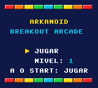
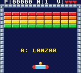
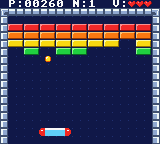
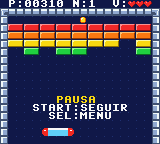
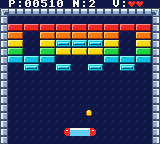
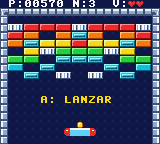
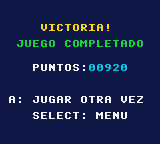
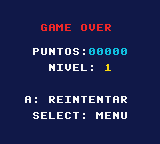

# Arkanoid / Breakout — Game Boy & Game Boy Color (Proyecto FPGBC)

Videojuego arcade estilo **Breakout / Arkanoid** desarrollado en **C** con **GBDK-2020**, compatible con Game Boy clásica (DMG), Game Boy Color (CGB), emuladores (**BGB**, **mGBA**) y la consola FPGA del proyecto **FPGBC**.

---

## 1. Descripción y Mecánicas Principales

- **Resolución nativa:** `160 × 144 px` con gráficos 2bpp propios y paletas CGB personalizadas (conservando contraste nítido en pantallas DMG monocromáticas).
- **Control preciso de la barra:** Movimiento horizontal fluido dentro del campo cerrado (`[8, 120]` px) con rebote direccional de la pelota según la zona de impacto (extremos, zona media y centro).
- **Sistema de bloques y resistencia:**
  - Bloques estándar de **1 impacto** en 5 colores (`40` a `100` pts).
  - Bloques **reforzados de 2 HP** (`20` pts por impacto + `150` pts al destruir).
  - Bloques **blindados de 3 HP** (`25` pts por impacto + `250` pts al destruir).
- **Dificultad progresiva:** La velocidad de la pelota aumenta progresivamente conforme avanza la partida y en cada nuevo nivel (5 niveles de velocidad interna en punto fijo).
- **Efectos de sonido por hardware APU:** Rebotes en pared y barra, impacto en bloque blindado, destrucción de bloque, pausa, pérdida de vida y fanfarrias de nivel superado, Game Over y victoria usando los canales nativos de sonido de Game Boy.
- **HUD en pantalla:** Puntuación (`P`), nivel actual (`N`) y vidas restantes (`V`, inicio con 3 vidas).

---

## 2. Niveles Incluidos

| Nivel | Nombre | Descripción |
| :---: | :--- | :--- |
| **1** | `CLASICO` | 4 filas completas (36 bloques) ideales para dominar el rebote direccional. |
| **2** | `FORTALEZA` | 40 bloques con pasillos laterales y núcleo central de bloques reforzados de 2 HP. |
| **3** | `CIUDADELA` | 47 bloques con combinaciones de bloques reforzados (2 HP) y blindados (3 HP). |

### Puntuación por Tipo de Bloque

| Tipo / Color | Impactos (HP) | Puntos por Golpe | Puntos al Destruir |
| :--- | :---: | :---: | :---: |
| Rojo | 1 | — | 100 |
| Naranja | 1 | — | 80 |
| Amarillo | 1 | — | 60 |
| Verde | 1 | — | 50 |
| Cian | 1 | — | 40 |
| Reforzado | 2 | 20 | 150 |
| Blindado | 3 | 25 | 250 |

---

## 3. Controles

| Acción | Botón Game Boy | Tecla en BGB (Estándar) |
| :--- | :--- | :--- |
| **Mover barra / Navegar menú** | Cruceta Izquierda / Derecha / Arriba / Abajo | Flechas de dirección |
| **Lanzar pelota / Iniciar ronda** | Botón `A` | Tecla `S` / `Z` |
| **Iniciar desde menú / Pausar o reanudar** | `START` (o `A` en menú) | `Enter` |
| **Volver al menú (en pausa, Game Over o Victoria)** | `SELECT` | `Barra Espaciadora` |

---

## 4. Estructura de Archivos

```text
Arkanoid/
├── README.md          # Documentación del proyecto
├── arkanoid.gb        # ROM lista para ejecutar (32 KB, GB / GBC)
├── compile.bat        # Script de compilación automática con GBDK-2020
├── main.c             # Inicialización de hardware y bucle principal a 60 FPS
├── game.h / game.c    # Máquina de estados, física de pelota, barra y colisiones
├── levels.h / levels.c# Definición y renderizado de los 3 niveles y desgaste de bloques
├── sound.h / sound.c  # Motor de efectos y fanfarrias con APU nativa de Game Boy
├── tiles.h / tiles.c  # Recursos gráficos 2bpp, tipografía y paletas CGB
└── imagenes/          # Capturas verificadas del juego
```

---

## 5. Cómo Ejecutar y Compilar

### Ejecutar directamente
Abre el archivo **`arkanoid.gb`** en **BGB**, **mGBA** o cárgalo en el hardware/cartucho **FPGBC**.

### Compilar desde el código fuente
Requiere **GBDK-2020** (v4.5.0 o compatible; puedes definir la variable de entorno `GBDK` o `GBDK_HOME`). Desde esta carpeta ejecuta:

```cmd
compile.bat
```

Esto genera la ROM **`arkanoid.gb`** (32.768 bytes, modo híbrido `-Wm-yc` compatible con Game Boy y Game Boy Color).

---

## 6. Capturas de Pantalla

| Pantalla de Título | Nivel 1 — Inicio |
| :---: | :---: |
|  |  |

| Nivel 1 — En Juego | Pausa |
| :---: | :---: |
|  |  |

| Nivel 2 — Fortaleza | Nivel 3 — Ciudadela |
| :---: | :---: |
|  |  |

| Victoria | Game Over |
| :---: | :---: |
|  |  |
