# Diagramas del quemador

Metodología: para cada bloque hay (1) un **diagrama de caja negra** con sus entradas y salidas, (2) un **diagrama de bloques** que separa el camino de datos de la unidad de control y (3) el **diagrama de flujo (ASM)** de la unidad de control. En los diagramas ASM, cada rectángulo es un estado y lista las salidas que valen 1 en ese estado (máquina de Moore); los rombos son las decisiones.

Los diagramas están en Mermaid; GitHub los dibuja solos al abrir este archivo.

Jerarquía:

```
cart_bridge (top)
├── uart_rx    = sincronizador + contador_dec + contador_inc + comparador + rsr_rx + control_uart_rx
├── fifo_rx
├── uart_tx    = registro + rsr_tx + contador_dec + contador_inc + comparador + control_uart_tx
├── cart_bus   = registro x4 + mux4 + contador_dec + control_cart_bus
├── registro, contador_inc, contador_dec, comparador, mux4, deco_cmd, deco_arg, rom_version
└── control_bridge
```

---

## 1. Sistema completo: `cart_bridge`

### Caja negra

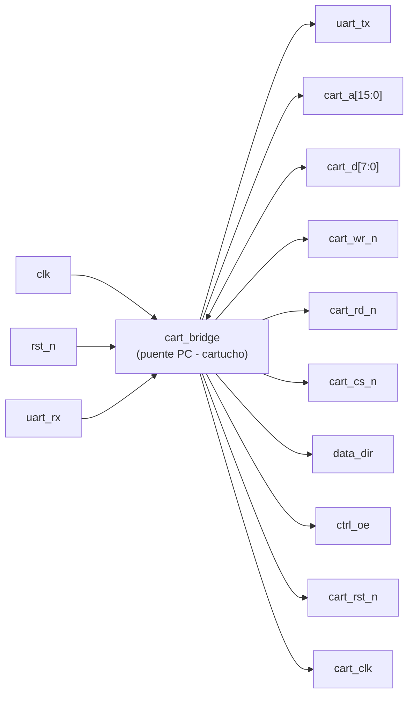

| Señal | Dir. | Ancho | Función |
| --- | --- | --- | --- |
| `clk` | E | 1 | Reloj de 40 MHz (pin 11) |
| `rst_n` | E | 1 | Reset activo en bajo (pin 120) |
| `uart_rx` / `uart_tx` | E / S | 1 | Serial con el PC por el puerto link (pines 27 / 28) |
| `cart_a` | S | 16 | Dirección A0–A15 del conector |
| `cart_d` | E/S | 8 | Datos D0–D7 del conector |
| `cart_wr_n`, `cart_rd_n`, `cart_cs_n` | S | 1 c/u | Control del bus (activos en bajo) |
| `data_dir` | S | 1 | Dirección del level shifter de datos |
| `ctrl_oe`, `cart_rst_n`, `cart_clk` | S | 1 c/u | Constantes: 1, 1 y 0 |

### Diagrama de bloques

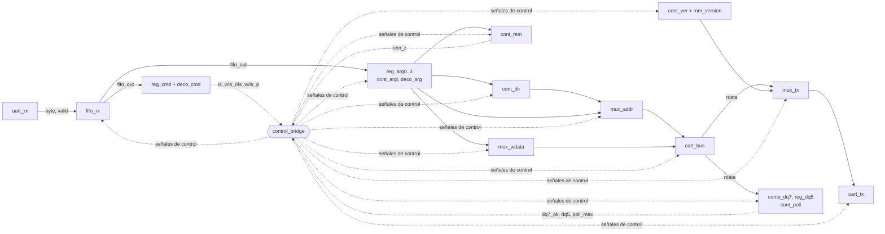

### ASM de `control_bridge`

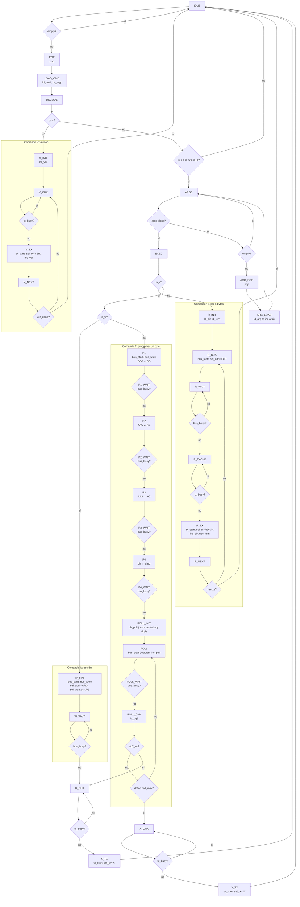

(Los estados `Pn_WAIT` y `POLL_WAIT` vuelven a sí mismos mientras `bus_busy = 1`; en el diagrama se dibujaron como un solo rombo para no recargarlo.)

---

## 2. Ciclo de bus: `cart_bus`

### Caja negra

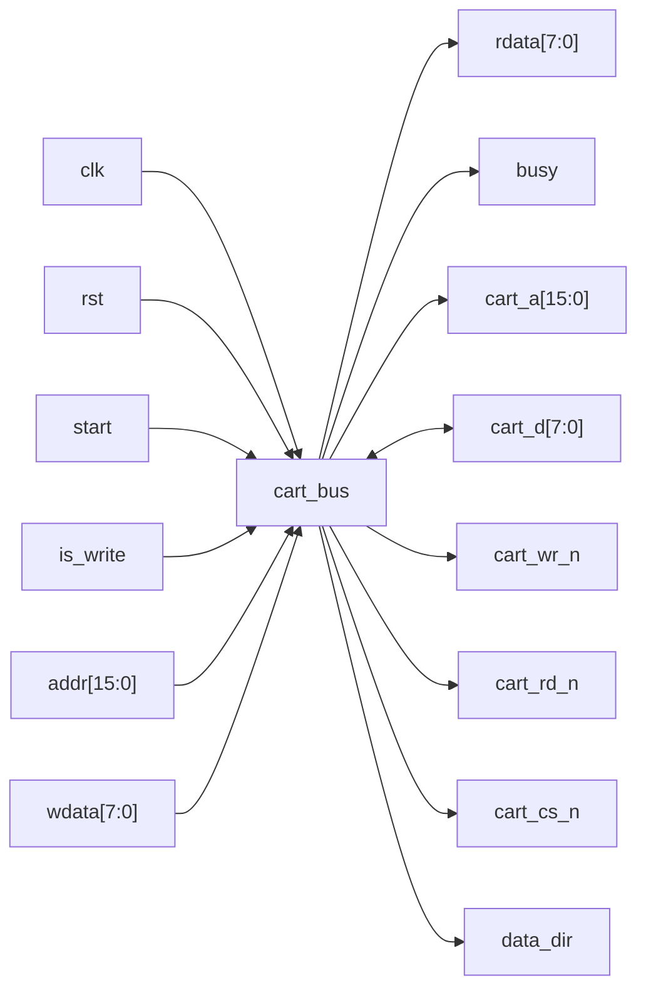

### Diagrama de bloques

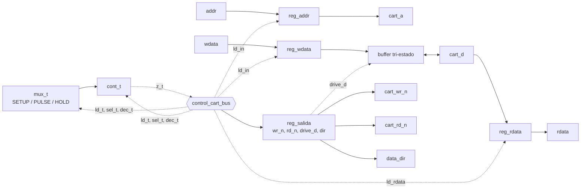

### ASM de `control_cart_bus`

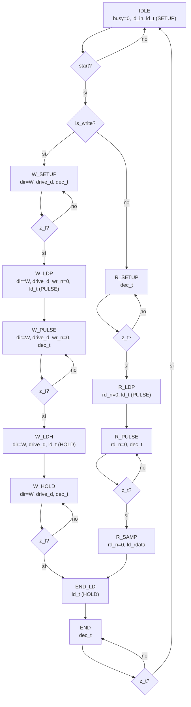

En todos los estados que no lo dicen: `wr_n = rd_n = 1`, `drive_d = 0`, `dir` apunta del cartucho a la FPGA y `busy = 1`. Las salidas pasan por `reg_salida` antes de llegar a los pines, así que llegan un ciclo después y sin glitches.

---

## 3. Receptor serial: `uart_rx`

### Caja negra

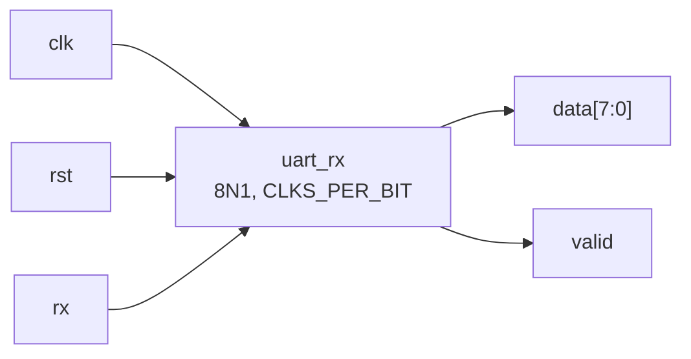

### Diagrama de bloques

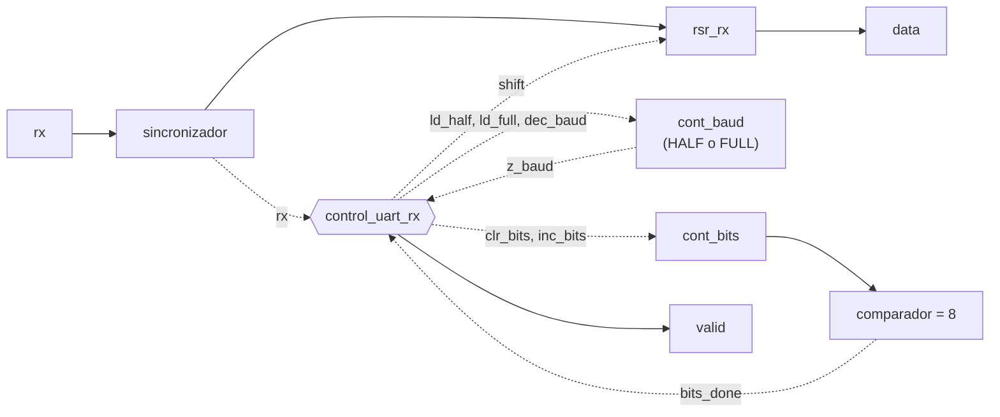

### ASM de `control_uart_rx`

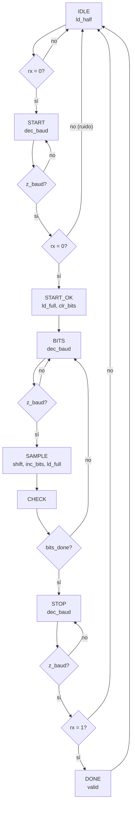

---

## 4. Transmisor serial: `uart_tx`

### Caja negra

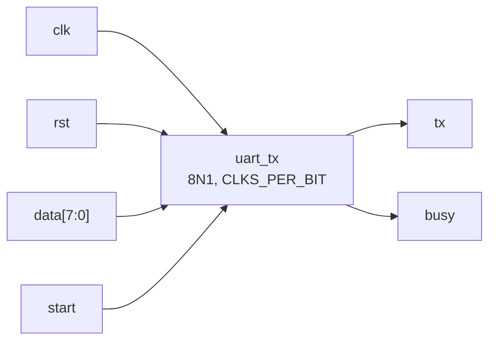

### Diagrama de bloques

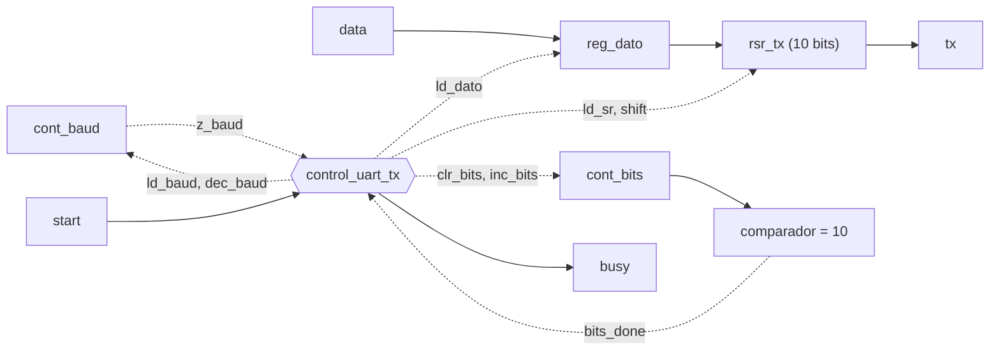

### ASM de `control_uart_tx`

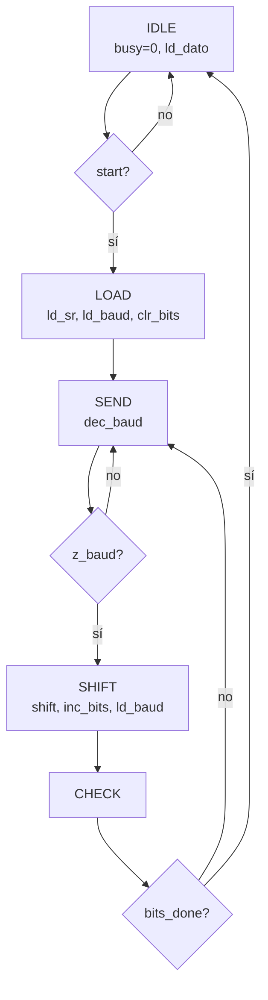

---

## Módulos del camino de datos (`rtl/datapath/`)

| Módulo | Qué hace | Dónde se usa |
| --- | --- | --- |
| `registro` | Registro con carga, borrado y valor de reset | Comando, argumentos, dirección, datos, `reg_salida`, `reg_dq5`, `reg_dato` |
| `contador_dec` | Contador descendente con carga y bandera `z` | Tiempos de bit (UART), tiempos de bus, bytes restantes |
| `contador_inc` | Contador ascendente con borrado y carga | Bits UART, índice de argumento, dirección de lectura, sondeos, versión |
| `comparador` | Igualdad | Fin de bits, fin de argumentos, DQ7, límite de sondeo, fin de versión |
| `mux4` | Multiplexor 4 a 1 | Dirección y dato del bus, byte a transmitir, carga del contador de tiempos |
| `rsr_rx` | Desplazamiento a la derecha con entrada serial | `uart_rx` |
| `rsr_tx` | Desplazamiento de 10 bits con salida serial | `uart_tx` |
| `sincronizador` | Dos flip-flops para la entrada asíncrona | `uart_rx` |
| `fifo_rx` | Memoria de 512 bytes con punteros | Bytes recibidos |
| `deco_cmd` | Decodifica el comando y cuántos argumentos espera | `cart_bridge` |
| `deco_arg` | Decodificador 2 a 4: qué argumento se carga | `cart_bridge` |
| `rom_version` | Caracteres de "FPGBC1" | `cart_bridge` |
