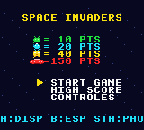
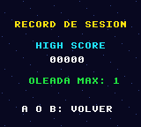
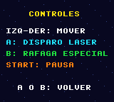
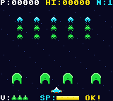
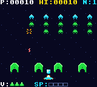
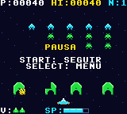
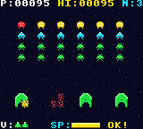
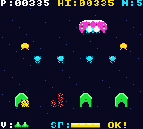
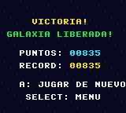
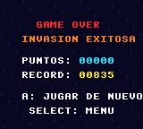

# Space Invaders — Game Boy & Game Boy Color (Proyecto FPGBC)

Videojuego arcade completo estilo **Space Invaders** desarrollado en **C** con **GBDK-2020**, compatible con Game Boy clásica (DMG), Game Boy Color (CGB), emuladores (**BGB**, **mGBA**) y la consola FPGA del proyecto **FPGBC**.

---

## 1. Descripción y Mecánicas Principales

- **Resolución nativa:** `160 × 144 px` usando modo de VRAM sin solapamiento (`LCDCF_BG8800`), sprites propios 2bpp, campo estelar de fondo y paletas CGB personalizadas.
- **Nave del jugador:** Movimiento horizontal acotado a `[8, 136]` px, animación de disparo en el cañón, explosión de derrota e **invulnerabilidad temporal** tras reaparecer (comienzo con 3 vidas).
- **Dos tipos de disparo:**
  - **Láser estándar (`A`):** Hasta 2 disparos normales activos simultáneamente.
  - **Ráfaga especial triple (`B`):** Lanza 3 proyectiles de plasma en abanico (`daño = 2`, `vx = -1, 0, +1`) al llenar los 4 segmentos de la barra **`SP`** destruyendo enemigos.
- **Choque de disparos en el aire:** Los láseres propios destruyen proyectiles enemigos (`+10` pts); la ráfaga especial atraviesa y sigue subiendo.
- **4 Barreras defensivas destructibles:** Cada escudo consta de 4 celdas independientes de `8 × 8` px con **3 niveles de resistencia** (verde intacta -> amarillo agrietada -> rojo crítica -> destruida), desgastándose ante disparos propios, disparos enemigos o contacto de invasores.
- **OVNI especial:** Aparece periódicamente en la franja superior otorgando **`+150` pts** (o **`+300` pts** si se destruye con disparo especial).
- **HUD permanente y récord de sesión:** Muestra puntaje actual (`P`), récord de la sesión (`HI`), nivel (`N`), vidas (`V`) y barra especial (`SP`).

---

## 2. Niveles, Enemigos y Puntuación

| Nivel | Nombre | Formación / Enemigos | Mecánicas Destacadas |
| :---: | :--- | :--- | :--- |
| **1** | `OLEADA 1` | 15 enemigos (3×5) | Velocidad base lenta, invasores básicos y tiradores. |
| **2** | `OLEADA 2` | 20 enemigos (4×5) | Mayor cadencia de disparo enemigo y avance más rápido. |
| **3** | `BLINDADOS` | 24 enemigos (4×6) | Incorpora fila superior blindada (`2 HP`) que cambia a rojo al sufrir daño. |
| **4** | `ASALTO` | 24 enemigos (4×6) | Incluye interceptores (`EN_DIVER`) que descienden en picada y disparos dirigidos hacia el jugador. |
| **5** | `JEFE FINAL` | Jefe `32×16 px` (`20 HP`) + 6 escoltas | Nave nodriza con triple disparo simultáneo y tema musical propio. |

### Tabla de Puntos

| Objetivo | Puntos |
| :--- | :---: |
| Invasor básico (`EN_GRUNT`) | 10 |
| Tirador alado (`EN_SHOOTER`) | 20 |
| Comandante blindado (`EN_ARMORED`) | 40 (+15 por impacto previo) |
| Interceptor en picada (`EN_DIVER`) | 50 (+15 por impacto previo) |
| OVNI especial | 150 (300 con disparo especial) |
| Jefe Final | 500 (+25 por cada impacto previo) |
| Intercepción aire-aire de disparo | 10 |

---

## 3. Audio Real en Hardware (APU de Game Boy)

Motor nativo implementado directamente sobre los registros de sonido de Game Boy (`NR10–NR52`), sin archivos externos:

- **Canal 1 (Pulso con barrido):** Efectos con sistema de prioridad para disparos láser, ráfaga especial, impactos, menú, pausa y aviso de OVNI.
- **Canal 2 (Pulso melódico):** Música de menú en bucle, marcha clásica de 4 notas con **tempo dinámico** (se acelera cuando quedan menos invasores), tema intenso del Jefe Final y fanfarrias de fin de oleada, Game Over y Victoria.
- **Canal 4 (Ruido):** Explosiones de enemigos y jugador, e impactos contra las barreras defensivas.

---

## 4. Controles

| Acción | Botón Game Boy | Tecla en BGB (Estándar) |
| :--- | :--- | :--- |
| **Mover nave / Navegar menú** | Cruceta Izquierda / Derecha / Arriba / Abajo | Flechas de dirección |
| **Disparo láser / Confirmar menú** | Botón `A` | Tecla `S` / `Z` |
| **Disparo especial triple** | Botón `B` | Tecla `A` / `X` |
| **Pausar o reanudar partida** | `START` | `Enter` |
| **Volver al menú (en pausa, Game Over o Victoria)** | `SELECT` | `Barra Espaciadora` |

---

## 5. Estructura de Archivos

```text
Space_invaders/
├── README.md           # Documentación del proyecto
├── SPACE_INVADERS.gb   # ROM lista para ejecutar (32 KB, GB / GBC)
├── compile.bat         # Script de compilación automática con GBDK-2020
├── main.c              # Inicialización de video/audio y bucle principal a 60 FPS
├── game.h / game.c     # Máquina de estados, jugador, disparos, colisiones, OVNI y Jefe Final
├── levels.h / levels.c # 5 oleadas, tipos de enemigos y sistema de 4 barreras destructibles
├── sound.h / sound.c   # Motor de audio APU (Canales 1, 2 y 4) y música dinámica
├── tiles.h / tiles.c   # Tiles 2bpp, campo estelar, tipografía y paletas CGB
└── imagenes/           # Capturas verificadas del juego
```

---

## 6. Cómo Ejecutar y Compilar

### Ejecutar directamente
Abre el archivo **`SPACE_INVADERS.gb`** en **BGB**, **mGBA** o cárgalo en el hardware/cartucho **FPGBC**.

### Compilar desde el código fuente
Requiere **GBDK-2020** (v4.5.0 o compatible; puedes definir la variable de entorno `GBDK` o `GBDK_HOME`). Desde esta carpeta ejecuta:

```cmd
compile.bat
```

Esto genera la ROM **`SPACE_INVADERS.gb`** (32.768 bytes, modo híbrido `-Wm-yc` compatible con Game Boy y Game Boy Color).

---

## 7. Capturas de Pantalla

| Pantalla de Título | High Score de Sesión |
| :---: | :---: |
|  |  |

| Controles | Nivel 1 — Inicio |
| :---: | :---: |
|  |  |

| Combate Activo | Pausa |
| :---: | :---: |
|  |  |

| Nivel 3 — Blindados (2 HP) | Nivel 5 — Jefe Final (20 HP) |
| :---: | :---: |
|  |  |

| Victoria | Game Over |
| :---: | :---: |
|  |  |
